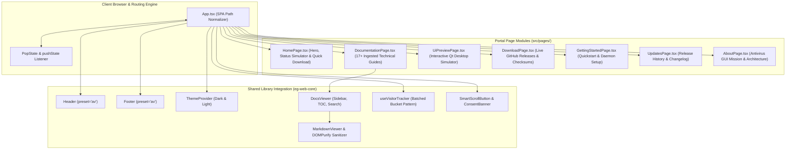

# pyEGClamUI Antivirus Portal (`av.eg1.in`)

Modern documentation portal and application showcase for [pyEGClamUI](https://av.eg1.in), the open-source graphical user interface for ClamAV, built with **React 18**, **TypeScript**, and **Vite**, powered by the generic [`eg-web-core`](https://github.com/EG1DOTIN/eg-web-core) library.

---

## 🏗️ Architecture & Component Flow



---

## 🚀 Key Architectural Highlights

1. **Powered by EG-Web-Core Library**:
   - Reusable primitives: [`Header`](https://github.com/EG1DOTIN/eg-web-core/blob/main/docs/layout-components.md) (`preset="av"`), [`DocsViewer`](https://github.com/EG1DOTIN/eg-web-core/blob/main/docs/domain-modules.md), [`MarkdownViewer`](https://github.com/EG1DOTIN/eg-web-core/blob/main/docs/domain-modules.md), and telemetry services.
   - Clean separation of portal branding (`PyEgClamUiLogo`) from library components.
2. **Interactive Desktop UI Simulator (`DesktopSimulator`)**:
   - In-browser interactive simulation of the PyQt5/PyQt6 desktop interface with live status toggling (Secure, Warning, Critical) and mock file scanner modal.
3. **17+ Ingested Technical Guides**:
   - Complete technical documentation suite ingested from Markdown sources with instantaneous client search, table of contents (TOC), and syntax-highlighted code snippets.
4. **Live GitHub Releases Synchronization**:
   - Fetches real-time release artifacts, release notes, and assets directly from the GitHub API (`EG1DOTIN/pyEGClamUI`) with caching and rate-limit backoff.
5. **GDPR-Compliant Anonymous Telemetry**:
   - 50-record batched bucket telemetry via [`useVisitorTracker`](https://github.com/EG1DOTIN/eg-web-core/blob/main/docs/hooks-and-services.md).

---

## 🗺️ Application Pages & Routes

All routes support clean URLs and static hosting via SPA rewrites:

| Route / Path | Page Component | Features & Modules |
| :--- | :--- | :--- |
| **`/`**, **`index.html`** | [`HomePage`](./src/pages/HomePage.tsx) | Hero banner, real-time Qt status simulation, quick download CTA |
| **`documentation.html`** | [`DocumentationPage`](./src/pages/DocumentationPage.tsx) | 17+ technical documentation guides, sidebar, search, TOC |
| **`ui-preview.html`** | [`UiPreviewPage`](./src/pages/UiPreviewPage.tsx) | Interactive desktop Qt UI simulator with status toggle and mock scan execution |
| **`download.html`** | [`DownloadPage`](./src/pages/DownloadPage.tsx) | Live GitHub Releases sync, platform-specific installers (.deb, .rpm, .tar.gz), SHA-256 checksums |
| **`getting-started.html`** | [`GettingStartedPage`](./src/pages/GettingStartedPage.tsx) | Quickstart setup, ClamAV daemon configuration, first scan instructions |
| **`updates.html`** | [`UpdatesPage`](./src/pages/UpdatesPage.tsx) | Release history, version changelog with tags, security advisories |
| **`about.html`** | [`AboutPage`](./src/pages/AboutPage.tsx) | Open-source antivirus GUI mission, architecture, and credits |

---

## 📦 Project Structure

```
av.eg1.in/
├── index.html                   # Main HTML5 entry point
├── package.json                 # Project dependencies & build scripts
├── tsconfig.json                # TypeScript strict configuration
├── vite.config.ts               # Vite configuration with eg-web-core linking
├── firebase.json                # Firebase Hosting rewrites & security headers
├── docs/                        # Comprehensive documentation portal
│   ├── README.md                # Documentation index
│   ├── architecture.md          # Architecture & desktop simulator
│   └── pages-and-features.md    # Deep page-by-page feature breakdown
├── public/                      # Static assets & release metadata
└── src/
    ├── App.tsx                  # Master routing shell & header/footer layout
    ├── index.css                # AV portal theme tokens & styling
    ├── main.tsx                 # React DOM mount point
    ├── components/              # Portal-specific branding & widgets
    │   ├── Logo.tsx             # pyEGClamUI SVG shield logo
    │   ├── DesktopSimulator.tsx # PyQt desktop simulator with live scan
    │   └── Footer.tsx           # AV portal footer component
    └── pages/                   # Application view components (7 pages)
        ├── HomePage.tsx
        ├── DocumentationPage.tsx
        ├── UiPreviewPage.tsx
        ├── DownloadPage.tsx
        ├── GettingStartedPage.tsx
        ├── UpdatesPage.tsx
        └── AboutPage.tsx
```

---

## 🛠️ Development & Build Commands

### 1. Install Dependencies
```bash
npm install
```

### 2. Start Local Development Server
```bash
npm run dev
```
Launches the Vite dev server with hot module replacement (HMR).

### 3. Build for Production
```bash
npm run build
```
Runs `tsc` typecheck and `vite build`, bundling all assets to `dist/`.

### 4. Preview Production Build
```bash
npm run preview
```
Runs a local web server serving the `dist/` production bundle for validation.

---

## 🔒 Security & Compliance Standards

- **DOMPurify Sanitization**: All documentation Markdown is passed through `sanitizeHtml()` to block XSS injection.
- **Protocol Enforcers**: Dynamic download URLs validated with `sanitizeUrl()`.
- **Hardened External Links**: Enforces `rel="noopener noreferrer"` across all external links.
