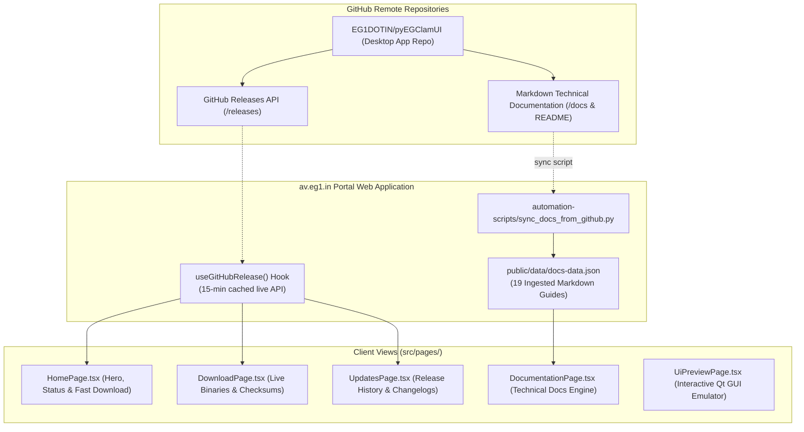
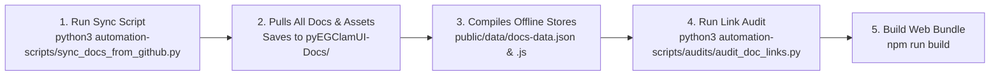

# pyEGClamUI Portal Developer & Operations Manual (`av.eg1.in`)

This manual provides clear, comprehensive, step-by-step instructions to maintain, update, extend, and deploy the **`av.eg1.in`** portal without needing to inspect raw source code.

---

## 🏗️ 1. Architecture & Component Flow

`av.eg1.in` is a React 18 + TypeScript + Vite SPA showcasing the [pyEGClamUI](https://github.com/EG1DOTIN/pyEGClamUI) cross-platform antivirus desktop application. It ingests the complete technical documentation suite from GitHub and queries releases dynamically.



---

## 🔄 2. Procedure: Syncing Documentation from GitHub

When new features, architecture changes, or release documentation are published in the `pyEGClamUI` GitHub repository:



### Single Command Execution:
From `AV-WEBSITE/av.eg1.in/`:
```bash
python3 automation-scripts/sync_docs_from_github.py
```
This automatically:
1. Queries the GitHub API tree for `EG1DOTIN/pyEGClamUI` (main branch).
2. Downloads all 20 technical guides, architectural specifications, and images into `pyEGClamUI-Docs/`.
3. Compiles `public/data/docs-data.json` and `public/data/docs-data.js` with mapped link aliases.

---

## 🏷️ 3. Procedure: Handling New Releases & Version Bumps

### Do You Need to Update Any Config Files for New Releases?
**No!** The live website automatically detects and renders new releases dynamically via the `useGitHubRelease` hook:
- The instant a new release tag (e.g. `v3.2.1` or `v3.3.0`) is published on GitHub, visitors will automatically see the new version and its download assets.
- If documentation was also updated in that release, simply run the sync script (`python3 automation-scripts/sync_docs_from_github.py`) to refresh the offline documentation cache.

---

## 🛡️ 4. Procedure: Running Verification Audits

Run the dedicated audit suite to confirm documentation integrity:

```bash
# 1. Validate that all 19 guides and release specs exist
python3 automation-scripts/audits/validate_docs_and_releases.py

# 2. Audit all cross-document markdown links for dead references
python3 automation-scripts/audits/audit_doc_links.py

# 3. Test the interactive Qt desktop GUI simulator states
python3 automation-scripts/audits/audit_simulator_integrity.py

# 4. Run all av.eg1.in automated checks together
python3 automation-scripts/run_all_checks.py
```

---

## 📄 5. Procedure: Add, Edit, or Remove a Page

1. **Create Page Component** in `src/pages/MyPage.tsx`.
2. **Register Route in `src/App.tsx`**:
   - Add clean path in `cleanRoute()`:
     ```ts
     if (raw === 'my-page') return 'my-page';
     ```
   - Add rendering case in `renderCurrentPage()`:
     ```tsx
     case 'my-page':
       return <MyPage onNavigate={navigateTo} />;
     ```
   - Add to `CLAMUI_NAV_LINKS`:
     ```tsx
     { label: 'My Page', href: 'my-page' }
     ```

---

## 🚀 6. Development, Build & Deployment Commands

Run these commands from `AV-WEBSITE/av.eg1.in/`:

```bash
# 1. Start local Vite development server (http://localhost:5173)
npm run dev

# 2. Type-check TypeScript code
npm run typecheck

# 3. Build production bundle to dist/
npm run build

# 4. Preview the production build locally
npm run preview

# 5. Deploy to Firebase Hosting (Production)
firebase deploy --only hosting
```

