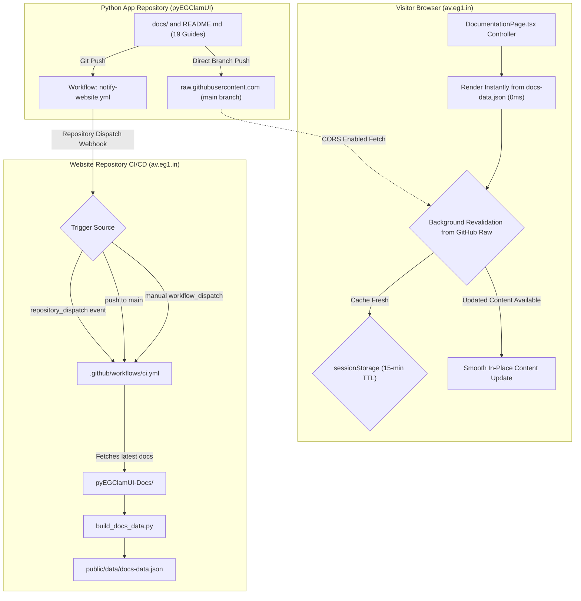

# GitHub Actions Documentation Synchronization Architecture

This document describes how technical documentation is maintained, synchronized, and compiled for the **pyEGClamUI** official web portal ([av.eg1.in](https://av.eg1.in)).

---

## 1. Architectural Overview

The documentation system uses a **hybrid real-time & ahead-of-time (AOT)** architecture:

1. **Client-Side Live GitHub Sync & Stale-While-Revalidate**: In [`../src/pages/DocumentationPage.tsx`](../src/pages/DocumentationPage.tsx), visiting the documentation page immediately renders the local pre-bundled documentation in 0ms (Stale-While-Revalidate) and simultaneously executes a non-blocking background fetch to `raw.githubusercontent.com`. Whenever updates are committed to the `main` branch of `EG1DOTIN/pyEGClamUI`, website visitors automatically receive the freshest documentation without waiting for website redeployment. Results are cached in `sessionStorage` (15-minute TTL).
2. **Ahead-of-Time Offline Bundle**: All 19 Markdown files in [`../pyEGClamUI-Docs/`](../pyEGClamUI-Docs/) are synchronized and compiled by [`../automation-scripts/sync_docs_from_github.py`](../automation-scripts/sync_docs_from_github.py) and [`../automation-scripts/build_docs_data.py`](../automation-scripts/build_docs_data.py) into offline-resilient data bundles: [`../public/data/docs-data.json`](../public/data/docs-data.json) and [`../public/data/docs-data.js`](../public/data/docs-data.js). This guarantees seamless offline browsing, fast initial loads, and search engine indexability.



---

## 2. Website Workflow Details

The CI/CD verification and deployment pipelines are defined in:
- [`.github/workflows/ci.yml`](../.github/workflows/ci.yml)
- [`.github/workflows/firebase-hosting-merge.yml`](../.github/workflows/firebase-hosting-merge.yml)

### Workflow Execution Lifecycle

1. **Checkout**: Checks out the website repository.
2. **Python Setup**: Initializes Python 3.11 runner environment.
3. **Node.js Setup**: Initializes Node.js 20 environment.
4. **Deterministic Compilation**: Runs `python automation-scripts/build_docs_data.py` to deterministically compile Markdown files into `public/data/docs-data.json` and `public/data/docs-data.js`.
5. **Quality & Link Audit Gate**: Runs `python automation-scripts/run_all_checks.py` to verify documentation integrity, simulator state, markdown links, and production build.
6. **Firebase Hosting Deployment**: Deploys the audited production build live to Firebase Hosting (`av.eg1.in`) on merge to `main`.

---

## 3. Connecting the pyEGClamUI App Repository

When publishing code and documentation to the `EG1DOTIN/pyEGClamUI` repository on GitHub, configure the counterpart workflow in that repository using the steps below.

### Step 1: Create a Personal Access Token (PAT)
To allow the app repository to trigger the website workflow via webhook:
1. In your GitHub account, go to **Settings** > **Developer Settings** > **Personal Access Tokens** > **Fine-grained tokens** (or Classic tokens).
2. Grant `Contents: Read and write` permission (or `repo` scope for classic tokens) targeting the website repository (`av.eg1.in`).
3. In the `pyEGClamUI` repository, go to **Settings** > **Secrets and variables** > **Actions**.
4. Add a new repository secret named `WEBSITE_REPO_TOKEN` containing this token.

### Step 2: Add the Trigger Workflow in `pyEGClamUI`
In the `pyEGClamUI` app repository, create the following workflow file:

**File path in pyEGClamUI**: `.github/workflows/notify-website.yml`

```yaml
name: Notify Website of Docs Update

on:
  push:
    branches:
      - main
    paths:
      - 'docs/**'
      - 'README.md'
  workflow_dispatch:

jobs:
  dispatch-to-website:
    name: Trigger Website Docs Sync
    runs-on: ubuntu-latest
    steps:
      - name: Dispatch Event to Website Repository
        run: |
          curl -X POST \
            -H "Accept: application/vnd.github.v3+json" \
            -H "Authorization: token ${{ secrets.WEBSITE_REPO_TOKEN }}" \
            https://api.github.com/repos/EG1DOTIN/av.eg1.in/dispatches \
            -d '{"event_type": "docs_updated", "client_payload": {"sender": "pyEGClamUI"}}'
```

---

## 4. Local Testing & Verification

You can verify the release synchronization and documentation pipeline locally at any time:

### Synchronize Documentation from GitHub
Fetch all markdown files directly from GitHub `main` branch into `pyEGClamUI-Docs/` and compile the data stores:
```bash
python3 automation-scripts/sync_docs_from_github.py
```

Expected output:
```text
Connecting to GitHub API for 'EG1DOTIN/pyEGClamUI' to discover repository documents...
Found 19 documentation assets on GitHub 'main' branch.
...
Successfully synchronized 19/19 assets to .../pyEGClamUI-Docs
Compiling public/data/docs-data.json and docs-data.js from updated documentation files...
Found 19 markdown files.
Successfully generated JSON docs store: .../public/data/docs-data.json
Successfully generated JS docs store:   .../public/data/docs-data.js
  Total documents compiled: 19
  Total link aliases mapped: 127
```

### Build Documentation Data Store
```bash
python3 automation-scripts/build_docs_data.py
```

### Run Master Quality Suite
```bash
python3 automation-scripts/run_all_checks.py
```

---

## 5. Summary of Key Files

| File Path | Description |
| :--- | :--- |
| [`.github/workflows/ci.yml`](../.github/workflows/ci.yml) | Website CI/CD GitHub Actions workflow for validating, compiling, auditing, and deploying the portal. |
| [`../automation-scripts/sync_docs_from_github.py`](../automation-scripts/sync_docs_from_github.py) | Python tool that pulls latest markdown files from pyEGClamUI GitHub repository main branch. |
| [`../automation-scripts/build_docs_data.py`](../automation-scripts/build_docs_data.py) | Deterministic Python generator script that compiles Markdown documents into JSON/JS stores. |
| [`../public/data/docs-data.json`](../public/data/docs-data.json) | Compiled JSON document data store loaded by DocumentationPage.tsx. |
| [`../src/pages/DocumentationPage.tsx`](../src/pages/DocumentationPage.tsx) | Client-side viewer controller handling instant local rendering (Stale-While-Revalidate), live GitHub revalidation, TOC, and search. |
| [`../pyEGClamUI-Docs/`](../pyEGClamUI-Docs/) | Authoritative local mirror of Markdown documents suite (19 technical guides). |
