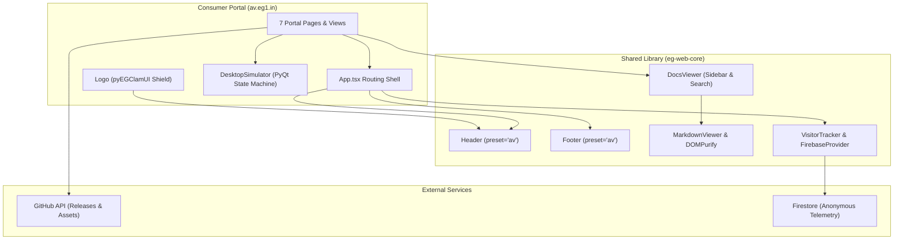

# pyEGClamUI Documentation Hub

Welcome to the technical documentation for **pyEGClamUI Portal** ([`av.eg1.in`](../)). This portal is built with React 18, TypeScript, and Vite, consuming the generic component framework [`eg-web-core`](https://github.com/EG1DOTIN/eg-web-core).

---

## 📚 Documentation Index

| Document | Focus & Scope | Key Topics Covered |
| :--- | :--- | :--- |
| **[Architecture & Desktop Simulator](./architecture.md)** | System architecture, Qt UI simulator & GitHub Releases sync | Simulator state machine, GitHub API client, telemetry |
| **[Pages & Feature Guide](./pages-and-features.md)** | Detailed implementation breakdown of all 7 pages | Home, Documentation, UI Preview, Download, Getting Started, Updates, About |
| **[EG-Web-Core Library Docs](https://github.com/EG1DOTIN/eg-web-core/blob/main/docs/README.md)** | Shared component specifications | UI Primitives, Layouts, Hooks, Services, Admin Suite |

---

## 🧭 System Topology

---

## 🛡️ Guidelines & Rules Compliance

1. **Modernized Consumer Architecture (Critical Rule 1)**:
   - This project is an independent, modernized React 18 + Vite + TypeScript application consuming `eg-web-core` as a modular dependency (`github:EG1DOTIN/eg-web-core`).
   - All generic, reusable components, styling, logic, hooks, and helpers are maintained in `eg-web-core`, while site-specific branding, customized wrappers, and domain pages reside strictly within this repository.
2. **Generic Core Library (Critical Rule 5)**:
   - All antivirus portal branding (`PyEgClamUiLogo`, custom desktop simulator styling) resides strictly inside this consumer project.
   - Core library components receive configuration via props and presets.
3. **Cross-Consumer Stability (Critical Rule 6)**:
   - Zero-regression builds confirmed with sibling projects `eg1.in` and `mchess.eg1.in`.
