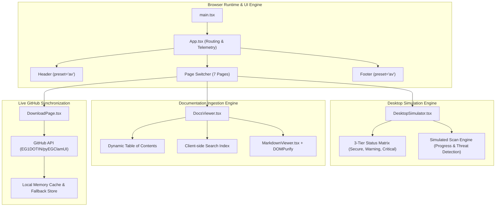
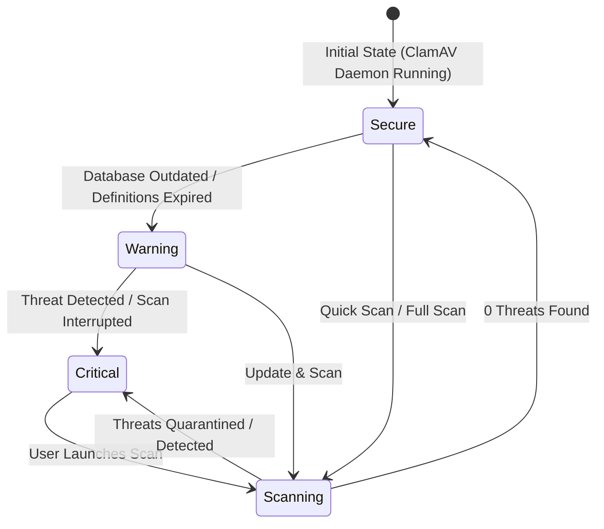

# Architecture & Desktop Simulator — pyEGClamUI Portal

This document outlines the architecture, desktop simulator state machine, GitHub releases synchronization engine, and documentation rendering pipeline powering [`av.eg1.in`](../).

---

## 🏗️ Architectural Topology

---

## 1. Desktop UI Simulator State Machine (`DesktopSimulator`)

The desktop simulator provides a live, interactive web representation of the native PyQt interface:

### State Matrix Properties
- **Secure (`state: 'secure'`)**: Green badge, shield checkmark, status "System Protected", ClamAV daemon running.
- **Warning (`state: 'warning'`)**: Amber badge, warning icon, status "Database Updates Available", prompt to run `freshclam`.
- **Critical (`state: 'critical'`)**: Red badge, alert icon, status "Threat Detected", prompt to inspect quarantine.

---

## 2. Live GitHub Releases Synchronization

The download engine on [`DownloadPage.tsx`](../src/pages/DownloadPage.tsx) keeps platform installers synchronized with GitHub:
1. **API Dispatch**: Requests `https://api.github.com/repos/EG1DOTIN/pyEGClamUI/releases/latest`.
2. **Asset Resolution**: Categorizes binary assets dynamically:
   - **Debian / Ubuntu**: `.deb` package
   - **Red Hat / Fedora**: `.rpm` package
   - **Generic Linux**: `.tar.gz` tarball
   - **Checksums**: Reads accompanying `SHA256SUMS` file to render verified verification hashes.
3. **Graceful Fallback**: If GitHub rate limits occur, falls back to pre-packaged release metadata without disrupting the user experience.

---

## 3. Documentation Ingestion Engine (`DocumentationPage`)

- Ingests 17+ technical Markdown guides covering setup, configuration, CLI usage, and troubleshooting.
- Interactive [`DocsViewer`](https://github.com/EG1DOTIN/eg-web-core/blob/main/docs/domain-modules.md) provides real-time search, table of contents navigation, and copyable code blocks.
- All Markdown is pre-sanitized through `DOMPurify` to ensure absolute immunity from XSS vulnerabilities.
